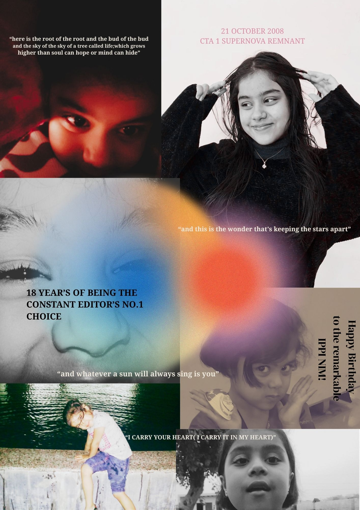
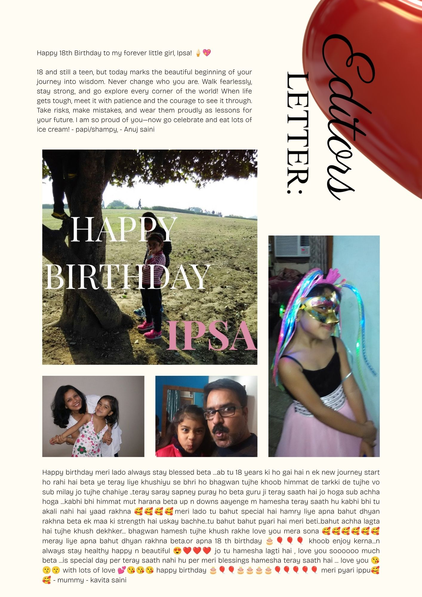
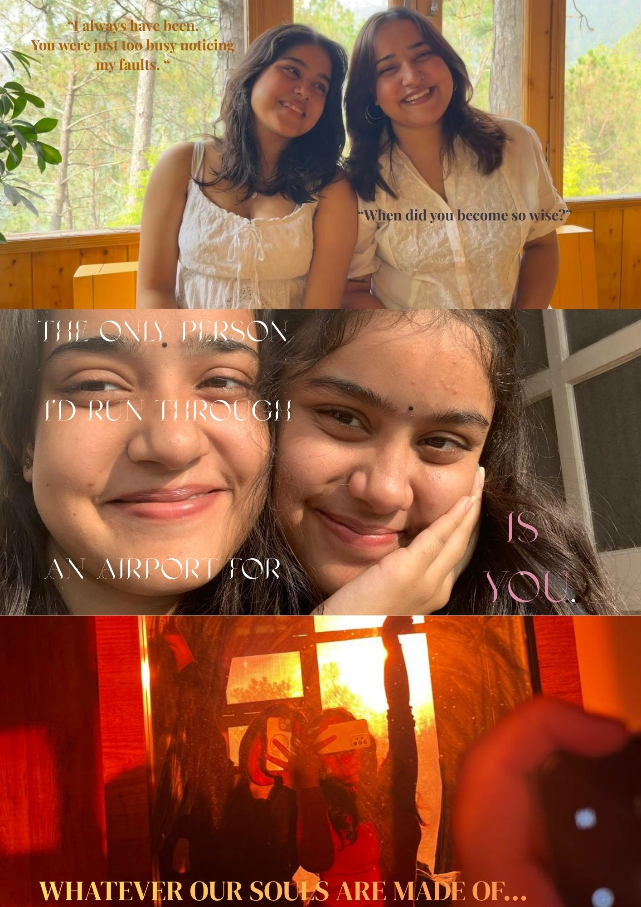
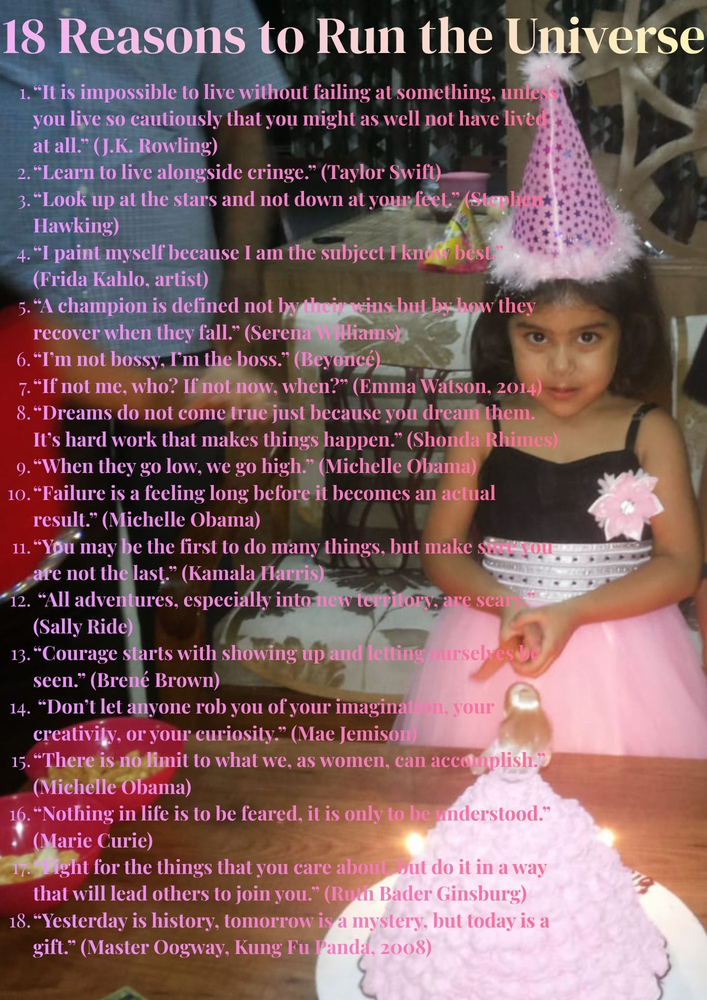
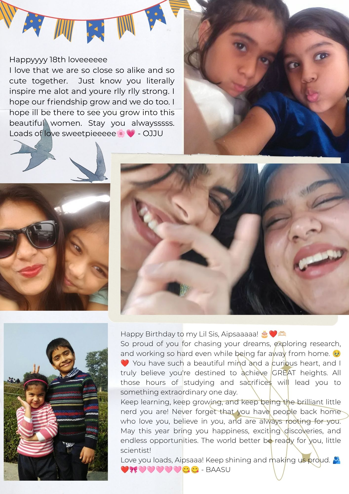
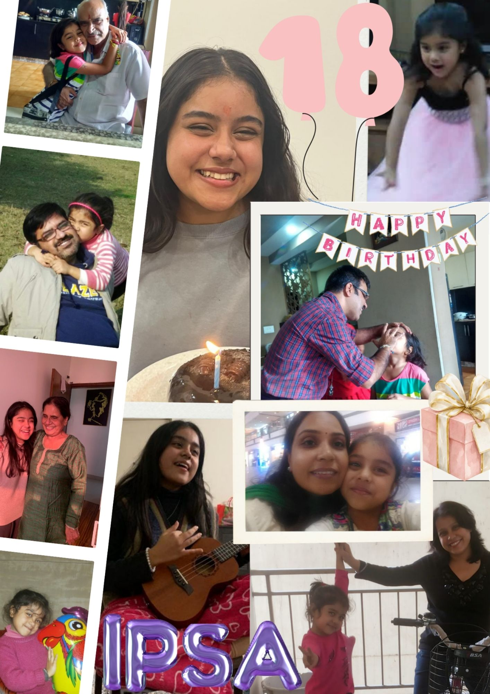
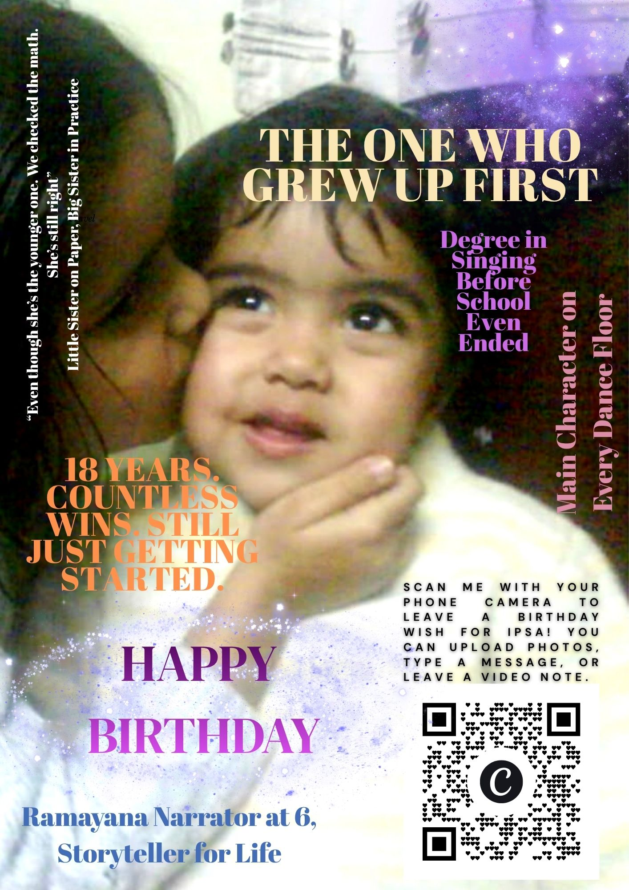

# 🗞️ IPSA'S 18TH BIRTHDAY ISSUE: THE DEBUT EDIT

### *A Milestone Publication • Volume 1, Issue 1*

Welcome to my digital editorial archive! This repository houses my very first passion project as a **Magazine Editor, Layout Designer, and Creative Director**. 

To celebrate a milestone 18th birthday, I challenged myself to step into the shoes of a publishing professional. I designed this entire multi-page fashion and lifestyle magazine **completely from scratch**, focusing heavily on modern editorial structures, visual balance, and clean typography.

---

## 🎨 Creative & Design Breakdown

Every page was meticulously planned to mirror a real, high-end print publication. The design language focuses on an elegant, editorial aesthetic:

*   **The Cover Spread:** A bold, high-contrast monochrome design utilizing a striking "Color Pop" blur effect. It establishes an immediate luxury-fashion magazine mood.
*   **The Editorial Column:** A masterclass in beige minimalism. Built with a crisp, multi-column grid layout, structured drop caps, and balanced white space for high-end readability.
*   **The Visual Centerpiece:** A modern Polaroid-style friends photo collage spread. This section seamlessly blends nostalgic print textures with clean, contemporary geometry.
*   **The Travel Feature:** A beautifully paced narrative layout combining expansive landscape imagery with asymmetrical text boxes to guide the reader through an immersive visual story.

---

## 🛠️ Project Specifications & Portfolio Skills

This project allowed me to develop and showcase a core suite of digital publishing and editorial skills:

| Creative Attribute | Technical Execution |
| :--- | :--- |
| **Design Platform** | Canva Pro (Zero templates used; constructed entirely from a blank canvas). |
| **Typography Focus** | Editorial font pairing, explicit hierarchy, letter-spacing mastery, and proper column alignment. |
| **Color Strategy** | A strict, cohesive palette dominated by organic beiges, deep blacks, and clean charcoal tones. |
| **Archival Tool** | GitHub (Utilized for version control and digital portfolio hosting). |

---

## 📖 How to View the Magazine

You can read the publication directly through this repository:
1. Look at the folder list above.
2. Click on the file named `ipsas-18th-birthday-issue.pdf` (or your uploaded images).
3. GitHub will open a beautiful, high-resolution preview where you can scroll through the entire layout page-by-page!

---
*"Every font choice tells a story, and every column layout creates a mood. This is just the beginning of my journey in creative direction."*
